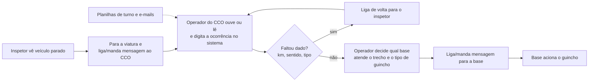
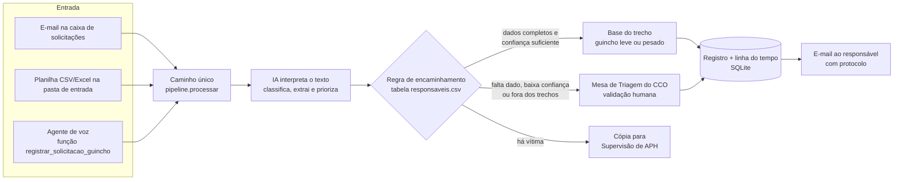

# Processo: solicitação de guincho — antes e depois da automação

Escopo da Sprint 1: do **relato de campo** até o **registro estruturado e o encaminhamento
ao responsável**. O acionamento do recurso e o atendimento (etapas 3 a 6 do material da
Motiva) continuam com as pessoas; a automação prepara e entrega a informação.

## Antes (AS-IS)

Baseado no fluxo "Contexto – Atual" apresentado pela Motiva (CFTV, 0800, Waze e inspetor →
validação e criação da ocorrência → CCO aciona o recurso).

**Dores**

| Dor | Efeito |
|---|---|
| O inspetor manuseia o celular/rádio para relatar | perde atenção no ambiente rodoviário (risco) |
| O operador redigita o que ouviu | erro de km/sentido, retrabalho, demora |
| Dados incompletos só são percebidos depois | ligações de volta, atraso no acionamento |
| A escolha da base depende da memória do operador | inconsistência entre turnos |
| E-mails e planilhas de turno entram fora do fluxo | pedidos esquecidos ou duplicados |
| Pouco registro de quem decidiu o quê e quando | baixa rastreabilidade |

## Depois (TO-BE)

**O que muda**

| Antes | Depois |
|---|---|
| Relato digitado por outra pessoa | O texto do inspetor é interpretado automaticamente |
| Falta de dado percebida tarde | A IA lista os campos faltantes e o pedido vai para a triagem |
| Base escolhida de memória | Regra fixa por rodovia, km e tipo de veículo, editável numa planilha |
| Prioridade subjetiva | Prioridade sugerida pela IA + regra fixa de segurança (vítima, carga perigosa ou faixa obstruída = ALTA) |
| Três canais separados | Um caminho único para e-mail, planilha e voz |
| Pouca rastreabilidade | Protocolo + eventos: recebida, interpretada, destino decidido, encaminhada |

## Onde está a decisão humana

A IA **não aciona** guincho. Ela interpreta; a regra escolhe o destino; o responsável decide
o acionamento. Casos duvidosos vão para a Mesa de Triagem do CCO. Isso atende aos critérios
transversais da Motiva: confirmação, rastreabilidade e governança.
